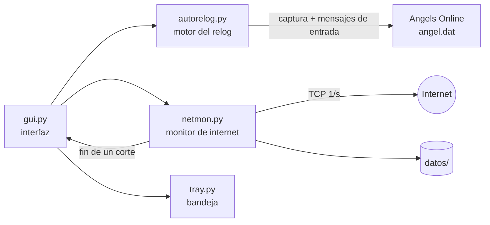

# AOG AutoRelog

Herramienta para **Angels Online Global** (Windows) que vuelve a entrar al juego sola cuando se corta la conexión, y que de paso deja registro de cuántas veces se cae tu internet y por cuánto tiempo.

> No es un programa oficial ni tiene relación con el juego ni con sus desarrolladores. Úsalo bajo tu responsabilidad: automatizar un juego online puede ir contra sus términos de servicio.

## Qué hace

**Relog automático**
- Detecta el cartel *"Connection to server has been interrupted"* y recorre el flujo hasta volver al mundo: servidor → canal → personaje → *Enter Game*, cerrando también los avisos de PIN, anuncios y Trade PIN.
- **No guarda contraseñas**: usa la sesión que el cliente ya tiene abierta (la pantalla de login no se toca).
- Recuerda el último canal (se lee del título de la ventana del juego) o usa uno fijo.
- Al volver al mundo activa el **Angel Baby** (Ctrl+R y tilda *Attack*), confirmando cada paso por imagen.

**Funciona con el juego en segundo plano**
- Reconoce la pantalla capturando la ventana aunque esté tapada (`PrintWindow`) y le manda los clicks y teclas como mensajes de ventana: no mueve tu mouse ni toma el foco.
- Si un paso se repite sin avanzar, escala el método: click corto → click largo → mouse real solo para ese click.
- Si el juego está **minimizado**, lo restaura sin darle el foco cuando vuelve internet, reloguea y lo vuelve a minimizar.

**Monitor de internet** (pestaña *Conexión*)
- Una prueba por segundo a tres servidores independientes (Cloudflare, Google, Quad9). Un corte se declara con fallas seguidas en los tres.
- Registra inicio, fin y duración de cada corte, latencia, % de pruebas fallidas y disponibilidad.
- Diagnóstico orientativo de la causa: hace ping al router durante el corte (router responde → proveedor; no responde → red local).
- Exporta un **informe HTML + CSV** pensado para adjuntar a un reclamo al proveedor, con la cobertura de la medición.

**Bandeja del sistema**: la ✕ oculta la ventana y el programa sigue corriendo; icono verde/rojo según haya internet, avisos y una sola instancia.

## Requisitos
- Windows 10/11
- Python 3.10 o superior
- Cliente de Angels Online Global en **inglés**, con la ventana a 1366×768 (otros tamaños funcionan, pero el reconocimiento es más lento)

## Instalación

```bat
python -m venv .venv
.venv\Scripts\pip install -r requirements.txt
```

## Uso

Doble clic en `AutoRelog.bat`, o:

```bat
.venv\Scripts\pythonw.exe gui.py
```

Por seguridad, la primera vez arranca en **modo ensayo** (solo anota lo que haría). Para que haga clicks de verdad, cambiá el interruptor de arriba a la derecha a `live`.

También hay modo consola:

```bat
.venv\Scripts\python.exe autorelog.py --live      # vigila y clickea
.venv\Scripts\python.exe autorelog.py --once      # un solo análisis
.venv\Scripts\python.exe autorelog.py --image captura.png   # prueba el reconocimiento sobre una captura
```

## Configuración

Se guarda en `config.json` (se crea al usar la pestaña *Ajustes*; `config.example.json` muestra todos los valores). Algunos útiles: `input` (`background` o `foreground`), `channel_fixed` (0 = recordar el último), `restore_minimized`, `peek_every_min`, `isp` (nombre del proveedor para el informe).

## Datos

Todo queda local, en `datos/`: `cortes.jsonl`, `latencia.csv`, `sesiones.jsonl`, `juego.jsonl`. Los informes se guardan en `informes/`. Ninguno de estos archivos está en el repositorio.

## Documentación

| Documento | Contenido |
|---|---|
| [Arquitectura](docs/ARQUITECTURA.md) | Diagramas de componentes, hilos y flujo; decisiones de diseño |
| [Cómo funciona](docs/FUNCIONAMIENTO.md) | Reconocimiento de pantallas, flujo del relog, envío de entrada, Angel Baby, juego minimizado |
| [Monitor de internet y datos](docs/DATOS.md) | Cómo se mide un corte, formato de los archivos, estadísticas e informe |
| [Configuración](docs/CONFIGURACION.md) | Todas las opciones de `config.json` |
| [Guía de desarrollo](docs/DESARROLLO.md) | Entorno, plantillas, cómo agregar pantallas y trampas conocidas |

## Arquitectura en una imagen



## Estructura

| Archivo | Qué es |
|---|---|
| `autorelog.py` | Motor: captura, reconocimiento por plantillas, clicks, relog, Angel Baby |
| `gui.py` | Interfaz (tkinter) |
| `netmon.py` | Monitor de internet, estadísticas e informes |
| `tray.py` | Icono de la bandeja (pywin32) |
| `templates/` | Recortes de la interfaz del juego usados para reconocer pantallas |

## Limitaciones conocidas
- Las plantillas están hechas con el cliente en inglés; otro idioma necesita plantillas nuevas.
- Solo mide internet mientras el programa está abierto; el informe indica la cobertura.
- No inyecta código ni lee la memoria del juego: solo captura la ventana y envía mensajes de entrada. Aun así, puede que el cliente cambie y haya que actualizar las plantillas.
