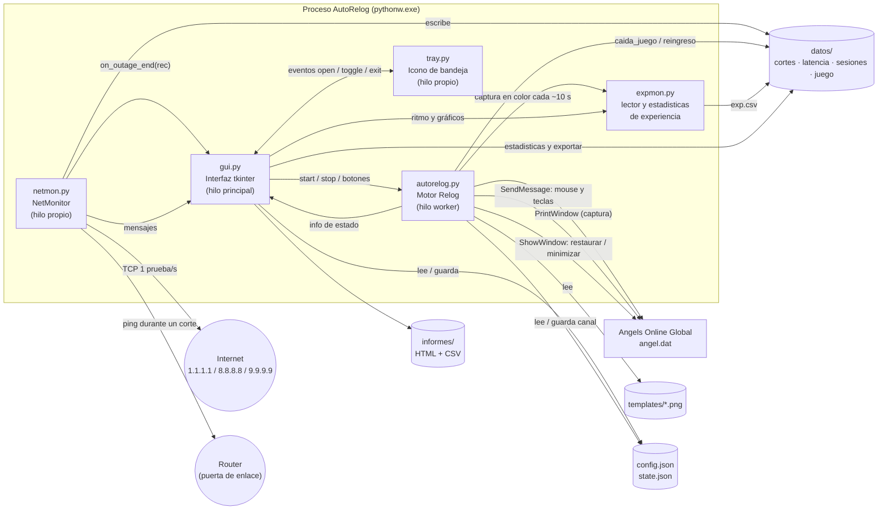
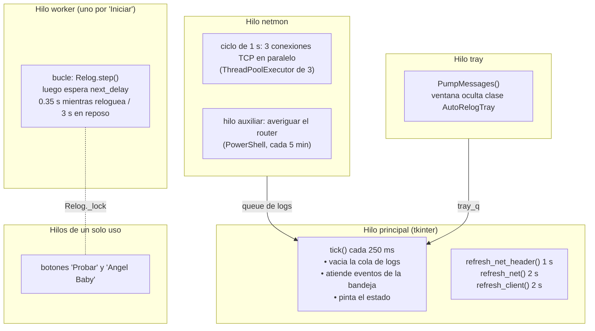
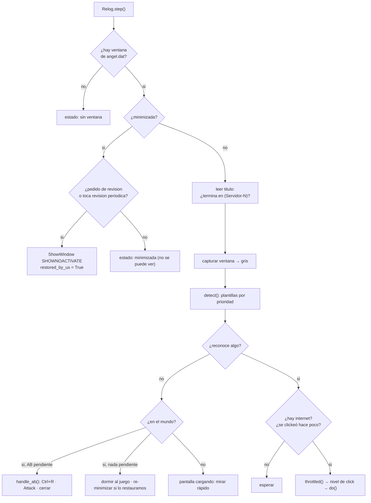
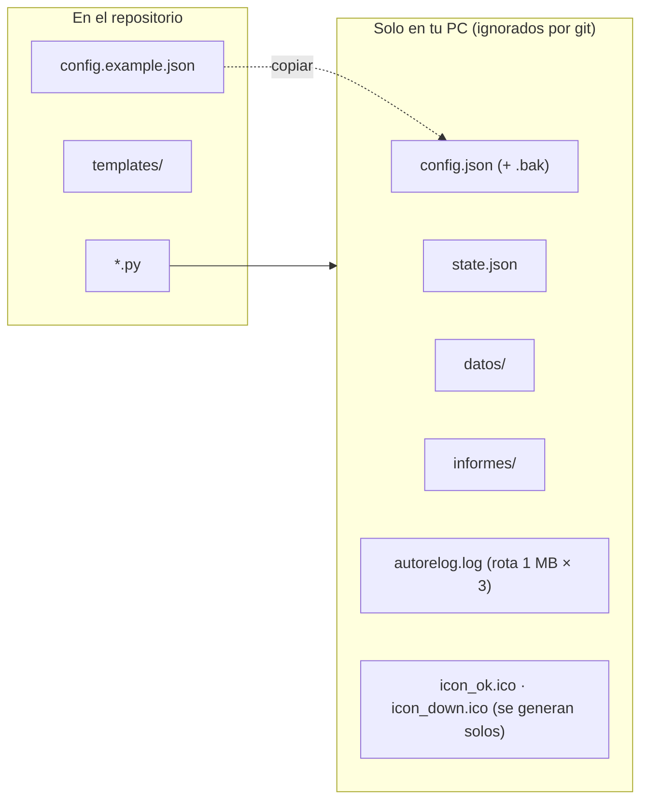

# Arquitectura

AutoRelog es una aplicación de escritorio de un solo proceso (Python + tkinter) con cuatro módulos y varios hilos. No toca el proceso del juego: lo **observa** capturando su ventana y le **envía** mensajes de entrada.

## Vista general

## Módulos

| Módulo | Responsabilidad | No debería |
|---|---|---|
| `autorelog.py` | Encontrar la ventana, capturarla, reconocer pantallas por plantillas, decidir qué hacer y ejecutar clicks/teclas. Contiene la clase `Relog` (máquina de estados). | Conocer tkinter. Funciona también por consola (`autorelog.py --live`). |
| `gui.py` | Interfaz, ajustes, pestaña de conexión, ciclo de vida de los hilos, bandeja, instancia única. | Hacer clicks al juego directamente (siempre pasa por `Relog`). |
| `netmon.py` | Medir internet, detectar cortes, guardar datos, calcular estadísticas y generar informes. | Saber del juego, salvo registrar eventos que le pasa el motor. |
| `expmon.py` | Leer el porcentaje de experiencia de una captura y calcular ritmo, ETA, subidas de nivel y estancamiento. No sabe de ventanas ni de clicks. | Capturar la pantalla: recibe una imagen. |
| `tray.py` | Icono en los iconos ocultos, menú, globos de notificación. Solo `pywin32`. | Tener lógica de negocio: solo emite eventos (`open`, `toggle`, `exit`). |

El acoplamiento es deliberadamente unidireccional: `gui` conoce a los demás, `autorelog` solo importa `netmon` (eventos del juego) y `expmon` (lectura de experiencia), y `netmon`/`expmon`/`tray` no importan a ningún otro módulo del proyecto.

## Hilos

Reglas de sincronización:

- **`Relog._lock`**: el ciclo del worker y los botones de prueba comparten el motor; el `RLock` garantiza que solo un hilo a la vez haga clicks sobre el juego.
- **`NetMonitor.lock`**: protege el estado que lee la interfaz (`snapshot()`, `current_minute()`).
- **Cola de logs**: los hilos nunca tocan widgets. Escriben al `logging`, un `QueueHandler` encola y `tick()` (hilo principal) pinta.
- La bandeja avisa a la interfaz solo con una `queue.Queue`.

## Ciclo de un paso del motor

Más detalle en [FUNCIONAMIENTO.md](FUNCIONAMIENTO.md).

## Decisiones de diseño (y por qué)

| Decisión | Motivo |
|---|---|
| **Capturar con `PrintWindow(PW_RENDERFULLCONTENT)`** en vez de capturar la pantalla | Funciona aunque otra ventana tape al juego. No funciona minimizado (por eso existe el "peek"). |
| **Reconocer por plantillas** (`cv2.matchTemplate`) y no por posiciones fijas | Las pantallas se identifican por su aspecto; los botones se ubican respecto del marcador, así que sobreviven a que el diálogo cambie de lugar. |
| **Enviar mensajes (`SendMessage`)** y no `SendInput` | No mueve el mouse real ni requiere foco. |
| **"Despertar" al juego** antes de cada entrada (`WM_ACTIVATEAPP`, `WM_NCACTIVATE`, `WM_ACTIVATE`, `WM_SETFOCUS`) | El cliente ignora mouse y teclado si cree que no está activo. Es lo que permite el modo segundo plano. |
| **Dejar al juego "despierto" durante toda una secuencia** y dormirlo recién al terminar | Dormirlo justo después de cada entrada hacía que descartara la tecla (la lee en su siguiente cuadro). |
| **Pulsaciones largas** (tecla 0.3 s, click 0.1 s ampliable a 0.4 s) | El juego lee la entrada por cuadro; una pulsación corta puede caer entre dos cuadros y perderse. |
| **Estacionar el cursor** del juego en `PARK = (900, 30)` tras cada click | El juego dibuja su cursor donde le mandamos el último movimiento: tapaba las plantillas y dejaba botones en estado *hover*, que bajaba la coincidencia. |
| **Click largo desde el primer intento** en carteles y login, y escalar si un paso se repite | El click corto nunca registraba ahí (el registro lo mostró en cada relog). Si el segundo plano falla igualmente, ese click usa el mouse real sin degradar el resto. |
| **Verificar visualmente la fila del canal** antes de aceptar | Un click perdido dejaba elegido el canal por defecto (el 1, a menudo lleno) y el relog terminaba en el canal equivocado. |
| **Monitor de internet independiente del juego** | Debe medir aunque la vigilancia esté detenida y servir como evidencia por sí solo. |
| **Tres servidores y 2 fallas seguidas** para declarar un corte | Evita falsos cortes por un servidor caído o una pérdida de un solo paquete. |
| **Escritura atómica** de `config.json` y `estado.json`, más copia `.bak` | Un corte de luz a mitad de escritura dejaba un JSON roto y el programa no arrancaba. |
| **Instancia única con mutex + ventana oculta de bandeja** | Dos instancias medirían a la vez sobre los mismos archivos. |

## Archivos en tiempo de ejecución

Formatos de los archivos de `datos/` en [DATOS.md](DATOS.md); todas las opciones de `config.json` en [CONFIGURACION.md](CONFIGURACION.md).
