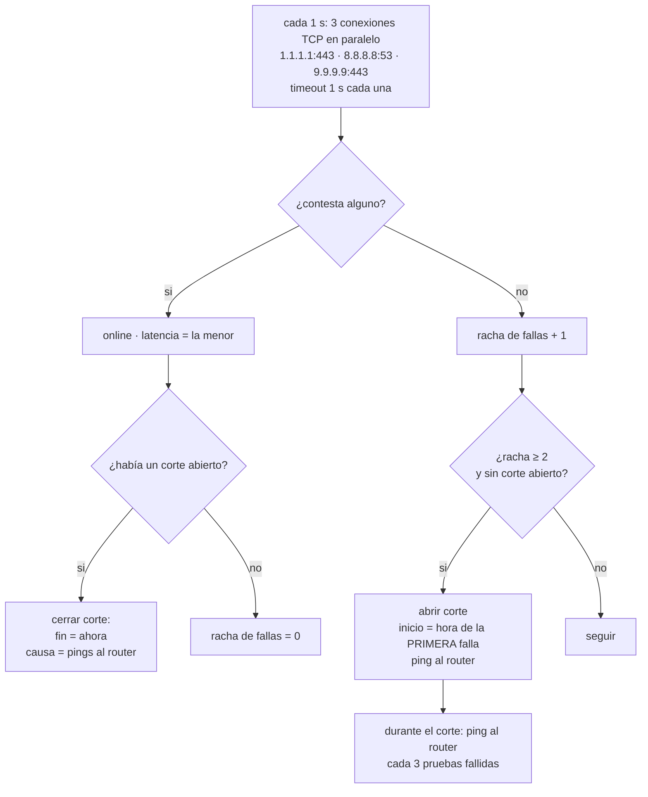

# Monitor de internet y datos

El monitor (`netmon.py`) corre mientras la aplicación esté abierta, **independiente de si el juego está siendo vigilado**.

## Cómo mide



Puntos finos:

- **El inicio de un corte es la hora de la primera prueba fallida**, no la de cuando se confirmó (2 s después). El fin es la primera prueba exitosa.
- **Se necesitan 2 fallas seguidas** (`CONFIRM`). Una falla aislada no es un corte (cuenta en el % de pruebas fallidas).
- **Causa orientativa** (`cause_of`):
  - si no hay puerta de enlace conocida → `red_local`;
  - si ≥ 50 % de los pings al router fallaron durante el corte → `red_local`;
  - si el router respondió → `proveedor`;
  - sin pings → `desconocida`.
- **El router** se averigua con `Get-NetRoute` de PowerShell, en un hilo aparte (se refresca cada 5 min) para no demorar el ciclo de medición.
- **Suspensión de la PC:** si pasan más de `GAP` = 20 s entre dos ciclos, se cierra la sesión como `suspension`, se marca incompleto el corte abierto (si lo había) y se empieza una sesión nueva. Ese tramo queda como "sin medir", no como corte.

## Archivos en `datos/`

Todos son de solo agregado, salvo `estado.json`.

### `cortes.jsonl` — un corte por línea

```json
{"inicio": 1791650000.1, "fin": 1791650184.3, "dur": 184.2, "causa": "proveedor",
 "gateway": "192.168.0.1", "gw_checks": 4, "gw_fails": 0, "incompleto": false}
```

| Campo | Significado |
|---|---|
| `inicio`, `fin` | Segundos epoch (hora local al mostrarse). |
| `dur` | Duración en segundos. |
| `causa` | `proveedor` · `red_local` · `desconocida`. |
| `gateway` | IP del router al momento del corte. |
| `gw_checks`, `gw_fails` | Pings al router hechos y fallidos durante el corte. |
| `incompleto` | `true` si el programa se cerró, se suspendió la PC o falló de golpe en medio del corte (el `fin` es el último dato confiable). |

### `latencia.csv` — un resumen por minuto

```
minuto_epoch,pruebas,fallidas,lat_media_ms,lat_max_ms
1791652980,60,0,20.9,30.1
```

Las columnas de latencia quedan vacías si no hubo ninguna prueba exitosa en ese minuto. El archivo solo crece, y las estadísticas lo leen **de forma incremental** (se recuerda la posición ya leída).

### `sesiones.jsonl` — cuándo estuvo midiendo

```json
{"inicio": 1791653011.4, "fin": 1791654643.3, "cierre": "normal"}
```

`cierre`: `normal` (cierre ordenado) · `abrupto` (se recuperó de `estado.json` tras un cierre inesperado) · `suspension` (la PC se durmió). Sirve para calcular la **cobertura**.

### `juego.jsonl` — eventos del juego

```json
{"t": 1791650100.0, "tipo": "caida_juego", "dur": null}
{"t": 1791650115.2, "tipo": "reingreso", "dur": 15.2}
```

`caida_juego` = apareció el cartel de conexión interrumpida. `reingreso` = el juego volvió al mundo; `dur` es el tiempo desde el cartel.

### `exp.csv` — lecturas de experiencia

```
t,pct,ganancia,tipo
1791670712.0,97.46,0.0,hb
1791670722.3,97.55,0.09,gain
```

| Campo | Significado |
|---|---|
| `pct` | Porcentaje de la barra de nivel (0–99.99). |
| `ganancia` | Experiencia ganada (o perdida, si es negativa) respecto de la lectura anterior, en puntos porcentuales. |
| `tipo` | `gain` ganó · `lvl` subió de nivel · `loss` perdió (p. ej. murió) · `hb` latido sin cambios (cada 60 s, para medir el tiempo activo). |

Solo se escribe cuando la experiencia cambia, más un latido por minuto. Ver [EXPERIENCIA.md](EXPERIENCIA.md).

### `estado.json`

```json
{"session": {"start": 1791654879.6, "last": 1791654880.6}, "outage": null}
```

Se reescribe cada 10 s (latido) y al abrir/cerrar un corte. Si el programa muere sin avisar, al volver a abrir se usa para cerrar lo que quedó abierto con `last` como hora de fin.

## Cálculo de estadísticas

Sobre el período elegido (Hoy / 7 días / 30 días / Todo):

| Dato | Cálculo |
|---|---|
| Cortes | Los que se solapan con el período (incluye uno en curso). |
| Tiempo sin internet | Suma de los solapes. |
| Medido | Suma del solape de cada sesión con el período. |
| **Cobertura** | `medido / duración del período` (máx. 100 %). |
| **Disponibilidad** | `1 − min(sin internet, medido) / medido`. |
| Pruebas fallidas | `fallidas / pruebas` de `latencia.csv` + el minuto en curso (aún no volcado). |
| Latencia | Media ponderada por pruebas exitosas; máxima = máximo de los máximos por minuto. |

## Informe para el proveedor

`export_report()` genera en `informes/`:

- `informe_conexion_<fecha>.html`: resumen, tabla de cortes, eventos del juego y una sección **"Cómo se midió"** que describe el método y sus límites (medición desde un solo equipo, diagnóstico de causa orientativo, solo hay datos con el programa abierto).
- `cortes_<fecha>.csv`: separador `;` y BOM UTF-8 para abrirlo bien en Excel.

El HTML incluye el nombre del equipo (`socket.gethostname()`) y, si lo configuraste, el del proveedor (`isp`).
