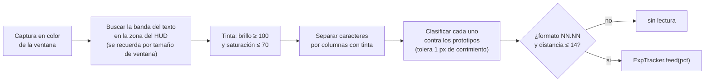

# Experiencia: lectura del HUD y estadísticas

La pestaña **Experiencia** muestra el porcentaje de experiencia actual, el ritmo por hora, lo ganado en la sesión, el tiempo estimado al próximo nivel, las subidas de nivel y la experiencia perdida por muertes. También avisa si el personaje deja de ganar experiencia.

El código está en `expmon.py`; el motor (`autorelog.py`) lo llama desde el ciclo de vigilancia.

## Cómo se lee

El cliente dibuja `NN.NN %` en el HUD con una tipografía de píxeles de unos 4×7 píxeles (la misma de HP y MP). No hay OCR general: se reconoce esa fuente concreta.



Por qué cada paso es así:

- **Tinta por saturación, no por brillo.** La barra de experiencia es rosa, la de HP naranja y la de MP azul; en escala de grises sus reflejos se confunden con el texto. El texto es gris/blanco (saturación baja), el fondo es de color. Con "brillo ≥ 100 y saturación ≤ 70" se aísla el texto sin importar el color de la barra.
- **Separación por columnas.** Con la máscara anterior cada carácter es un bloque contiguo, así que basta cortar en las columnas vacías. En todas las capturas de entrenamiento el número de bloques coincidió con el de caracteres.
- **Comparación con corrimiento.** Cada carácter se pega en un lienzo de 10×7 y se compara con los prototipos desplazados ±1 píxel en cada eje, porque el mismo dígito varía un píxel de ancho según el fondo.
- **El punto decimal** se reconoce por tamaño (un cuadradito de ≤ 3×3).
- **El `%` queda fuera de la banda** a propósito (empieza en x ≈ 197).

## Calibración automática del HUD

El texto no está siempre en el mismo lugar: el juego guarda un diseño de HUD por resolución (`save/cfg/wob_<ancho>_<alto>.xml`), y el *Render Fix* también cambia cómo se dibujan los números. Por eso `DigitReader` **busca** el texto en lugar de leerlo en coordenadas fijas:

1. Recorre las filas de la zona del HUD (`ROI`) y, en cada una, prueba empezar a leer desde cada bloque de tinta.
2. Se queda con la posición donde sale un número válido (`d.dd` o `dd.dd`) con la menor distancia a los prototipos. Las otras líneas del HUD (HP y MP, con `/`) no tienen punto decimal y se descartan solas.
3. Recuerda esa posición para el tamaño de ventana (`(alto, ancho)`). Si falla 3 lecturas seguidas, la olvida y vuelve a buscar (como máximo una vez cada 30 s).

La búsqueda tarda ~170 ms una sola vez; después cada lectura cuesta ~7 ms.

## Fiabilidad

Medido con tus capturas:

| Prueba | Resultado |
|---|---|
| Los 14 cuadros de entrenamiento | 14 de 14 lecturas de experiencia correctas |
| 20 capturas nuevas, una cada 3 s | 20 de 20 con lectura y coherentes (`97.46 %`, confirmado a ojo) |
| Validación cruzada dejando un cuadro afuera | ~98,9 % de caracteres (los errores fueron siempre 5↔6 cuando faltaba su único ejemplo) |

El lector se entrenó con pocos ejemplos de algunos dígitos (`1` y `6`: 2 cada uno), así que **cuantas más horas de uso, mejor podría afinarse** (ver más abajo). Para que un error ocasional no ensucie las estadísticas hay validaciones en `ExpTracker.feed`:

| Situación | Qué hace |
|---|---|
| La experiencia **baja menos de 0,30 %** | Se toma como error de lectura y se ignora (no cuenta como pérdida). |
| Salto sospechoso (baja > 50 % o sube > 10 %) | Pide **una segunda lectura igual** antes de aceptarlo. |
| Baja > 50 % | Es una **subida de nivel**: ganancia = `(100 − anterior) + nuevo`. |
| Baja entre 0,30 % y 50 % | Es una **pérdida real** (por ejemplo, murió). |
| Formato inválido o carácter dudoso | No hay lectura; no se registra nada. |

## Cuándo mide

Solo cuando se cumplen todas:

1. La **vigilancia está iniciada** (la lectura va colgada del ciclo del motor).
2. El juego está **en el mundo**, sin carteles encima.
3. La ventana **no está minimizada** (no se puede capturar).
4. El HUD está a la vista. La posición del texto **se calibra sola** para cada tamaño de ventana (el juego guarda un diseño de HUD distinto por resolución); si no se logra leer durante ~1 minuto, el registro lo avisa una vez.

La lectura se hace cada ~10 s. Los tramos sin lectura (juego minimizado, relog, vigilancia detenida) **no cuentan como tiempo activo**.

## Qué se calcula

Todo sale de las filas guardadas en `datos/exp.csv` (ver [DATOS.md](DATOS.md)):

| Dato | Cálculo |
|---|---|
| **Ganada** | Suma de las ganancias (incluye las subidas de nivel) del período. |
| **Tiempo activo** | Suma de los intervalos entre lecturas consecutivas, **descartando** los mayores a 5 minutos. |
| **Exp por hora** | `ganada / tiempo activo × 3600` (requiere ≥ 2 min de datos). |
| **Ritmo (últ. 30 min)** | Lo mismo, solo con la última media hora: refleja cómo vas *ahora*. |
| **Próximo nivel en** | `(100 − exp actual) / ritmo` usando el ritmo de 30 min (o el de la sesión). |
| **Exp perdida** | Suma de las bajas reales. |
| **Sin ganar hace** | Tiempo desde la última ganancia, si hubo una lectura en los últimos 3 minutos. |

El gráfico muestra lo ganado en barras de 10 minutos durante las últimas 3 horas. El selector de período (Sesión / 1 hora / Hoy / Todo) cambia las tarjetas. **Sesión** empieza al abrir el programa; el botón *Reiniciar sesión* la pone a cero.

Los porcentajes son de la barra de nivel actual, no de experiencia absoluta: el HUD no muestra el total. "≈ 0,23 niveles" es simplemente `ganada / 100`.

## Aviso de "sin ganar experiencia"

Si pasan `exp_stall_min` minutos (10 por defecto, 0 = nunca) sin ganar nada, el registro muestra una advertencia y, con la ventana oculta, sale un globo en la bandeja:

> Sin ganar experiencia hace 10 min: ¿Angel Baby parado o personaje muerto?

Avisa **una sola vez por racha**: vuelve a avisar solo después de volver a ganar experiencia. No sabe *por qué* se frenó; solo que la barra no se mueve. Las subidas de nivel y las pérdidas también generan un aviso.

## Reentrenar los dígitos

Los prototipos están en `templates/exp_digits.npz`. Si cambia la tipografía del juego, el idioma, o querés mejorar los dígitos con pocos ejemplos, se regeneran a partir de capturas del HUD con su texto real:

```bat
.venv\Scripts\python.exe tools\train_digits.py etiquetas.json
```

```json
{"capturas/a.png": {"exp": "97.26", "hp": "3307/3478", "mp": "3242/3384"}}
```

Las capturas deben ser del área cliente (`autorelog.grab(hwnd)`) y, para entrenar, recortadas al HUD o completas; con `--append` se suman a los prototipos que ya hay. La experiencia, el HP y el MP usan la misma fuente, por lo que las tres líneas sirven para aprender dígitos; el HP y el MP cambian seguido y ayudan a cubrir dígitos que el porcentaje todavía no mostró. El script avisa si falta algún dígito.

## Límites

- Lee **solo el porcentaje**; no el nivel (usa otra tipografía, más fina), ni la experiencia absoluta, ni el oro.
- Los prototipos cubren los **dos estilos de texto** del juego (el original, grueso y con sombra, y el nítido del Render Fix). Si aparece un tercer estilo, hay que reentrenar.
- Con el juego minimizado no hay datos; el "peek" del programa restaura el juego para revisar carteles, pero **no** para leer experiencia.
