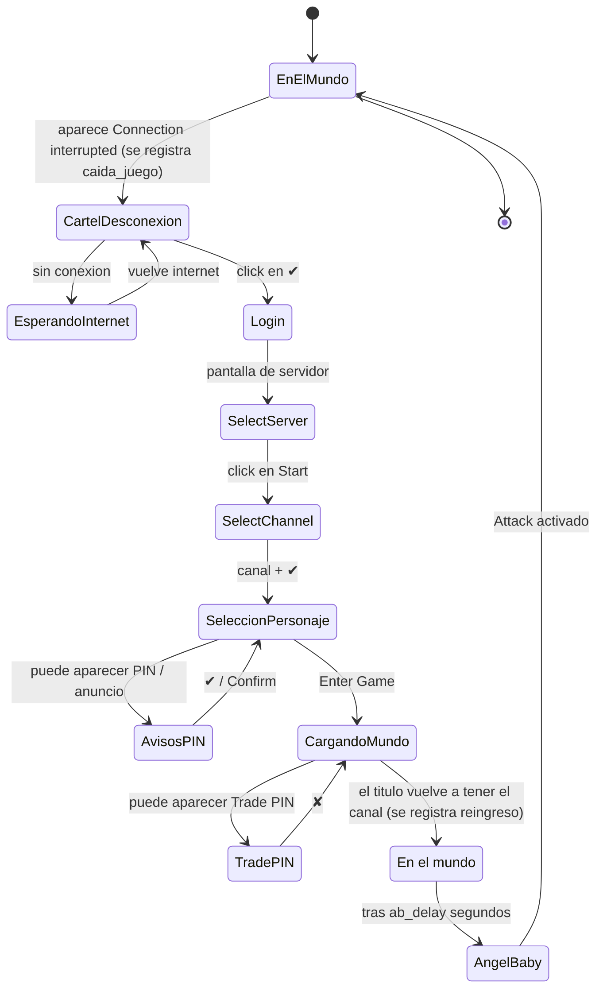
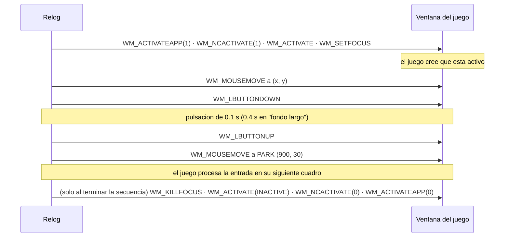
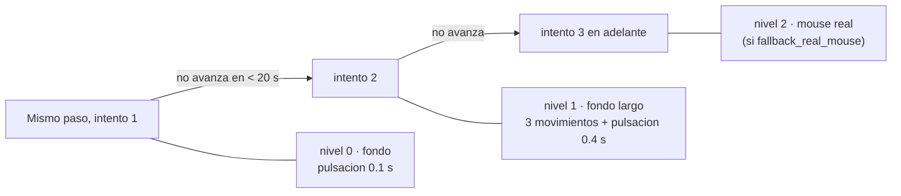
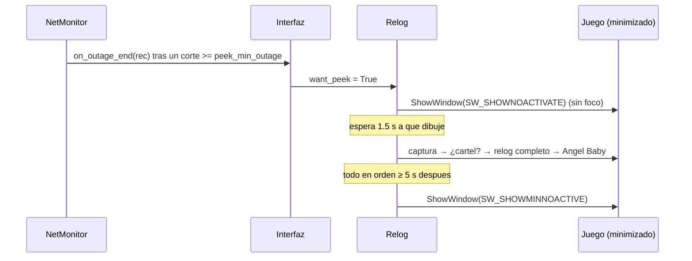

# Cómo funciona

## 1. Saber en qué estado está el juego

Se combinan dos señales:

**El título de la ventana.** Dentro del mundo es `Angels Online Global - cuenta(Servidor-Canal)`; en el login y la selección de personaje es solo `Angels Online Global`. Una expresión regular (`\((servidor)-(canal)\)\s*$`) distingue los dos casos y, de paso, da el canal actual para recordarlo.

**Plantillas de imagen.** La captura se pasa a gris y se busca cada plantilla con `cv2.matchTemplate` (`TM_CCOEFF_NORMED`). El umbral es `threshold` (0.8); la cabecera de *Select Channel* usa 0.9 porque se parece mucho a la de *Select Server*.

| Escala | Cuándo |
|---|---|
| `[1.0]` | La ventana mide exactamente 1366×768 (lo normal): reconocer cuesta ~50–150 ms. |
| 11 escalas (0.7–1.3) | Cualquier otro tamaño: funciona, pero tarda ~10 veces más. |

## 2. Reglas de reconocimiento

Se evalúan **en este orden**; la primera que coincide gana. Cada una tiene un *marcador* (texto que identifica la pantalla o cartel) y un *botón* que se busca en una zona debajo del marcador (`x−120 … x+320`, `y … y+420`, escalado). Las reglas sin marcador buscan el botón en toda la captura.

| # | Regla | Marcador | Botón | ¿Vale dentro del mundo? |
|---|---|---|---|---|
| 1 | `disconnect` | "Connection to server has been interrupted." | ✔ | sí |
| 2 | `pin` | "Please set a PIN to protect your account." | ✔ | no |
| 3 | `tradepin` | "Would you like to set a Trade PIN?" | ✘ | sí (opción `dismiss_trade_pin`) |
| 4 | `announcement` | — | *Confirm* | no |
| 5 | `server` | "Select Server" | *Start* | no |
| 6 | `channel` | "Select Channel" | fila del canal + ✔ | no |
| 7 | `character` | — | *Enter Game* | no |

Dentro del mundo solo se evalúan las reglas 1 y 3 (más barato y sin falsos positivos).

La regla `channel` no busca un botón: calcula la fila a partir de la cabecera (`CHANNEL_ROW0 = (108, 29)`, separación `20.25` px por canal) y el botón ✔ a `(136, 299)`; antes de aceptar vuelve a buscar el ✔ por imagen.

## 3. El flujo completo

Detalles que importan:

- **No actúa sin internet.** Antes de cada click comprueba conexión (`online()`); si no hay, espera. Así no malgasta intentos contra una pantalla que no puede avanzar.
- **No repite un click demasiado pronto.** `MIN_REPEAT`: `server` 3.5 s, `channel` 3 s, `character` 3.5 s, `disconnect` 2 s, el resto 1.5 s.
- **Freno de seguridad.** Si una misma regla se acciona `max_attempts` veces (8) en 60 s sin avanzar, pausa 60 s.
- **El "reingreso" solo cuenta tras haber pasado por el login**, porque al cerrar el cartel el título sigue "en el mundo" un instante.

## 4. Cómo se envía la entrada

### Modo `background` (por defecto)

Cada click o tecla va precedido de un "despertar" y seguido de estacionar el cursor:

Los mensajes se mandan con `SendMessageTimeout` (tope de 800 ms, `SMTO_ABORTIFHUNG`) para no colgar al programa si el juego se congela.

Las teclas (`Ctrl+R`) siguen el mismo esquema: `Ctrl` abajo → `R` abajo (0.3 s) → `R` arriba → `Ctrl` arriba.

### Escalado automático del método de click

El nivel se calcula contando cuántas veces se accionó **esa regla** en los últimos 20 s. El mouse real trae el juego al frente un instante y después devuelve el foco y la posición del cursor.

## 5. Angel Baby

Se arma después del paso `character` y se ejecuta cuando el juego vuelve al mundo y pasaron `ab_delay` segundos sin carteles:

1. Busca el panel por su texto "Enable Angel Baby" (o, si algo lo tapa, por la fila de pestañas).
2. Si no está abierto, manda `Ctrl+R` y espera hasta 4 s a que aparezca. **No** reenvía mientras espera (un segundo `Ctrl+R` lo cerraría).
3. Si no se ve la palabra *Attack*, hace click en la pestaña *Combat*.
4. Mira la casilla *Attack*: está tildada si hay ≥10 píxeles naranjas en su cuadro. Si no, hace click y verifica (hasta 3 veces).
5. Revisa *Enable Angel Baby* de la misma forma.
6. Cierra el panel con su botón ✕ (con `Ctrl+R` de respaldo).

Las posiciones son relativas al texto "Enable Angel Baby", así que sobreviven a que muevas el panel.

## 6. Juego minimizado

Una ventana minimizada no se puede capturar. Para no perder la relogueada:

También hay una revisión periódica (`peek_every_min`, 10 por defecto) para casos que el monitor de internet no ve, como una caída del servidor del juego con tu conexión bien.

Reglas para no estorbar:

- Si el juego está **visible**, descarta cualquier pedido de revisión y reinicia el temporizador (si no, al minimizarlo se abriría de golpe).
- Si lo **estás usando** (tiene el foco), no lo vuelve a minimizar.
- Si lo **minimizás vos** durante la revisión, deja de considerarlo suyo.
- Si el relog no termina en 3 minutos, lo deja abierto para que lo veas.

## 7. Constantes ajustables en el código

| Constante | Valor | Dónde |
|---|---|---|
| `PARK` | `(900, 30)` | `autorelog.py` |
| `SETTLE` | 0.9 s | `autorelog.py` |
| `MIN_REPEAT` | ver arriba | `autorelog.py` |
| `CHANNEL_*`, `AB_*` | offsets en px | `autorelog.py` |
| `TARGETS`, `INTERVAL`, `TIMEOUT`, `CONFIRM`, `GAP` | ver [DATOS.md](DATOS.md) | `netmon.py` |
