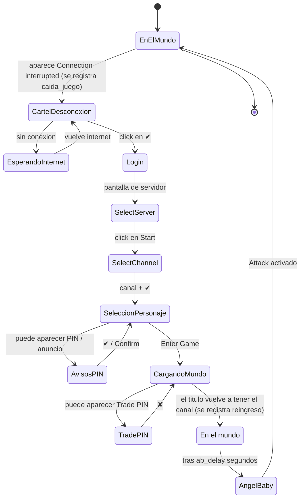
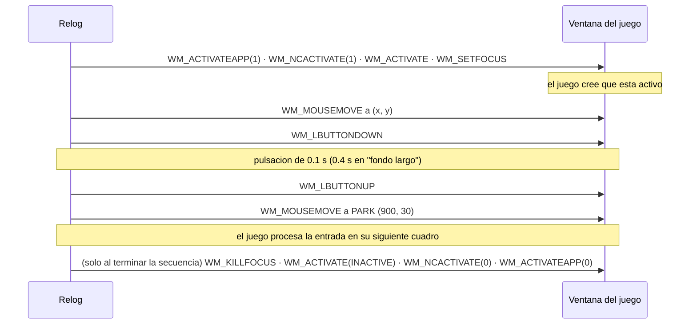
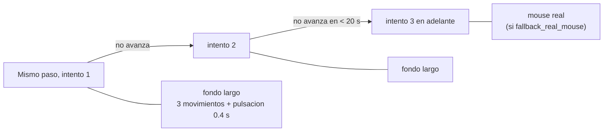
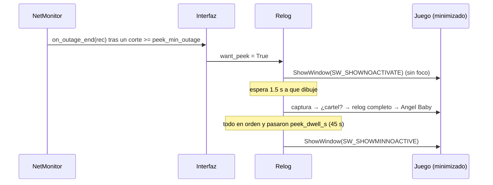

# Cómo funciona

## 1. Saber en qué estado está el juego

Se combinan dos señales:

**El título de la ventana.** Dentro del mundo es `Angels Online Global - cuenta(Servidor-Canal)`; en el login y la selección de personaje es solo `Angels Online Global`. Una expresión regular (`\((servidor)-(canal)\)\s*$`) distingue los dos casos y, de paso, da el canal actual para recordarlo.

**Plantillas de imagen.** La captura se pasa a gris y se busca cada plantilla con `cv2.matchTemplate` (`TM_CCOEFF_NORMED`). El umbral es `threshold` (0.8); la cabecera de *Select Channel* usa 0.9 porque se parece mucho a la de *Select Server*.

| Escala | Cuándo |
|---|---|
| `[1.0]` | Siempre por defecto. El juego dibuja su interfaz **1:1 en cualquier resolución** (cambia el tamaño de la ventana, no el de los botones), así que no hace falta escalar. Reconocer una pantalla cuesta ~50–400 ms según el tamaño de la captura. |
| 11 escalas (0.7–1.3) | Solo si durante ~4 s no se reconoce nada fuera del mundo y una búsqueda única con escalas encuentra la interfaz a otra escala (por ejemplo un modo que estira la imagen). Se activa para el resto de la sesión y queda en el registro. |

### Estilos de dibujo del juego

El texto del cliente se dibuja con **dos estilos** según la configuración del juego:

| Estilo | Cómo se ve | Plantillas |
|---|---|---|
| `sd` | El original: letras más gruesas, con sombra. | `templates/<nombre>.png` |
| `hd` | Con el *Render Fix* de BetterAngels (que parchea el ejecutable): trazos finos y nítidos. | `templates/hd/<nombre>.png` |

Cada plantilla puede tener las dos versiones. `find()` prueba primero el estilo que coincidió la última vez y, si no hay coincidencia, el otro; el resultado lleva `v` (`sd`/`hd`). Las **distancias** a botones y casillas también dependen del estilo: el panel del Angel Baby, por ejemplo, es más compacto en `hd` (`AB_LAYOUT`) y sus posiciones son otras. Hoy `hd` cubre **todo el flujo**: cartel de desconexión, *Select Server*, *Select Channel* (filas a 19 px), aviso de PIN, anuncio, selección de personaje (*Enter Game*), aviso de Trade PIN y el panel del Angel Baby. Las plantillas `hd` de PIN, anuncio, personaje y Trade PIN se armaron con capturas de pantalla completa del juego (1920×1032).

## 2. Reglas de reconocimiento

Se evalúan **en este orden**; la primera que coincide gana. Cada una tiene un *marcador* (texto que identifica la pantalla o cartel) y un *botón* que se busca en una zona debajo del marcador (`x−120 … x+320`, `y … y+420`, escalado). Las reglas sin marcador buscan el botón en toda la captura.

| # | Regla | Marcador | Botón | ¿Vale dentro del mundo? |
|---|---|---|---|---|
| 1 | `disconnect` | "Connection to server has been interrupted." | ✔ | sí |
| 2 | `pin` | "Please set a PIN to protect your account." | ✔ | no |
| 3 | `tradepin` | "Would you like to set a Trade PIN?" | ✘ | sí (opción `dismiss_trade_pin`) |
| 4 | `announcement` | — | *Confirm* | no |
| 5 | `server` | "Select Server" | *Start* | no |
| 6 | `channel` | "Select Channel" | fila del canal + ✔ | no |
| 7 | `character` | — | *Enter Game* | no |

Dentro del mundo solo se evalúan las reglas 1 y 3 (más barato y sin falsos positivos).

La regla `channel` no busca un botón: calcula la fila a partir de la cabecera (`CHANNEL_ROW0 = (108, 29)`, separación `20.25` px por canal) y el botón ✔ a `(136, 299)`; antes de aceptar vuelve a buscar el ✔ por imagen.

**Antes de aceptar se verifica que la fila quedó elegida.** La fila marcada se ve con fondo rojizo (el rojo supera claramente al azul; las demás son verde azulado), así que tras cada click se mide el color de las 5 filas. Si no quedó marcada la deseada, reintenta hasta 3 veces; si no lo logra, **no confirma** (aceptar sin elegir entraría al canal que viene marcado por defecto, normalmente el 1, que suele estar lleno). Al entrar al mundo compara el canal del título con el elegido y, si difiere, lo avisa en el registro y **no lo guarda como canal preferido**.

## 3. El flujo completo

Detalles que importan:

- **No actúa sin internet.** Antes de cada click comprueba conexión (`online()`); si no hay, espera. Así no malgasta intentos contra una pantalla que no puede avanzar.
- **No repite un click demasiado pronto.** `MIN_REPEAT`: `server` 3 s, `channel` 4 s, `character` 4.5 s, `disconnect` 3 s, `pin` 2.5 s, `announcement` 2.5 s, el resto 1.5 s. Solo se repite si la pantalla **sigue siendo la misma**; si ya cambió, se pasa a la siguiente.
- **Reintento rápido del click de *Start*.** Ese click, medido en `autorelog.log`, se pierde a menudo justo cuando aparece la pantalla. Tras clickearlo, a los `server_early_probe` (1 s) se compara la captura con la que había **justo antes** del click: si es idéntica, el click no registró y se reintenta de inmediato (sin esperar los 3 s de `MIN_REPEAT`, que costaban ~3 s de más). Si en cambio hay cualquier diferencia (aunque sea mínima), la pantalla está **cargando** (tras un *Start* exitoso el juego tarda ~2.4 s en mostrar *Select Channel*) y se deja pasar. El reintento escala al método de click del motor (fondo → fondo largo → mouse real) y se re-arma por si se pierde de nuevo. Con esto, un *Start* perdido suma ~1 s en vez de ~3.7 s.
- **Freno de seguridad.** Si una misma regla se acciona `max_attempts` veces (8) en 60 s sin avanzar, pausa 60 s.
- **El "reingreso" solo cuenta tras haber pasado por el login**, porque al cerrar el cartel el título sigue "en el mundo" un instante.

## 4. Cómo se envía la entrada

### Modo `background` (por defecto)

Cada click o tecla va precedido de un "despertar" y seguido de estacionar el cursor:

Los mensajes se mandan con `SendMessageTimeout` (tope de 800 ms, `SMTO_ABORTIFHUNG`) para no colgar al programa si el juego se congela.

Las teclas (`Ctrl+R`) siguen el mismo esquema: `Ctrl` abajo → `R` abajo (0.3 s) → `R` arriba → `Ctrl` arriba.

### Escalado automático del método de click

Se cuenta cuántas veces se accionó **esa regla** en los últimos 20 s. **Se empieza por el click largo** porque, medido en el registro de varias relogueadas, el click corto (pulsación de 0.1 s) nunca registró en carteles ni en el login: siempre hacía falta el segundo intento, lo que costaba ~4 s por pantalla. El click corto se sigue usando dentro del panel del Angel Baby, donde sí funciona. El mouse real trae el juego al frente un instante y después devuelve el foco y la posición del cursor.

## 5. Angel Baby

Se arma después del paso `character` y se ejecuta cuando el juego vuelve al mundo y pasaron `ab_delay` segundos sin carteles:

1. Busca el panel por su texto "Enable Angel Baby" (o, si algo lo tapa, por la fila de pestañas).
2. Si no está abierto, manda `Ctrl+R` y espera hasta 4 s a que aparezca. **No** reenvía mientras espera (un segundo `Ctrl+R` lo cerraría).
3. Si no se ve la palabra *Attack*, hace click en la pestaña *Combat*.
4. Mira la casilla *Attack*: está tildada si hay ≥10 píxeles naranjas en su cuadro. Si no, hace click y verifica (hasta 3 veces).
5. Revisa *Enable Angel Baby* de la misma forma.
6. Cierra el panel con su botón ✕ (con `Ctrl+R` de respaldo).

Las posiciones son relativas al texto "Enable Angel Baby", así que sobreviven a que muevas el panel.

## 6. Juego minimizado

Una ventana minimizada no se puede capturar. Para no perder la relogueada:

Cuándo se restaura el juego minimizado (cualquiera de estas):

| Disparador | Cuándo | Cuánto se queda restaurado |
|---|---|---|
| **Corte largo en curso** | El internet lleva `peek_during_outage_s` (45 s) caído. Así el programa ve el cartel apenas aparece y reloguea en el instante en que vuelve la conexión, sin depender de un solo aviso. | Todo el corte, y `peek_dwell_s` (45 s) después de que vuelva. |
| **Volvió internet** | Tras un corte de al menos `peek_min_outage` (3 s). | `peek_dwell_s` (45 s). |
| **Seguimiento** | A +60 s y +180 s de un corte de 30 s o más. | `peek_dwell_s` (45 s). |
| **Revisión periódica** | Cada `peek_every_min` (10 min) si sigue minimizado: cubre lo que el monitor de internet no ve, como una caída del servidor del juego con tu conexión bien. | 6 s. |

**Por qué se queda 45 s y no unos segundos.** El cliente puede mostrar el cartel de desconexión *después* de que vuelve internet: en un corte real se vio aparecer 6 s más tarde. Si se lo vuelve a minimizar antes, el cartel pasa desapercibido hasta la próxima revisión periódica y parece que "no vuelve a conectar". Con el juego visible esto no pasa porque el programa sigue mirando.

Al restaurar, se comprueba que la captura no sea un cuadro vacío (el juego puede tardar en dibujar): se espera hasta 12 s y, si sigue vacía, se avisa y el juego se deja abierto para que lo veas. Cada decisión de este camino queda en el registro, incluida la de **no** revisar cuando la vigilancia está detenida.

Reglas para no estorbar:

- Si el juego está **visible**, descarta cualquier pedido de revisión y reinicia el temporizador (si no, al minimizarlo se abriría de golpe).
- Si lo **estás usando** (tiene el foco), no lo vuelve a minimizar.
- Si lo **minimizás vos** durante la revisión, deja de considerarlo suyo.
- Si el relog no termina en 3 minutos, lo deja abierto para que lo veas.

## 7. Constantes ajustables en el código

| Constante | Valor | Dónde |
|---|---|---|
| `PARK` | `(900, 30)` | `autorelog.py` |
| `SETTLE` | 0.9 s | `autorelog.py` |
| `MIN_REPEAT` | ver arriba | `autorelog.py` |
| `CHANNEL_*`, `AB_*` | offsets en px | `autorelog.py` |
| `TARGETS`, `INTERVAL`, `TIMEOUT`, `CONFIRM`, `GAP` | ver [DATOS.md](DATOS.md) | `netmon.py` |
